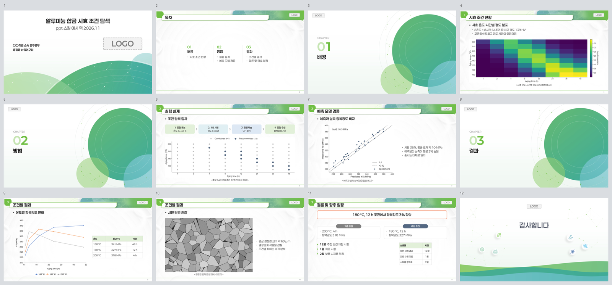
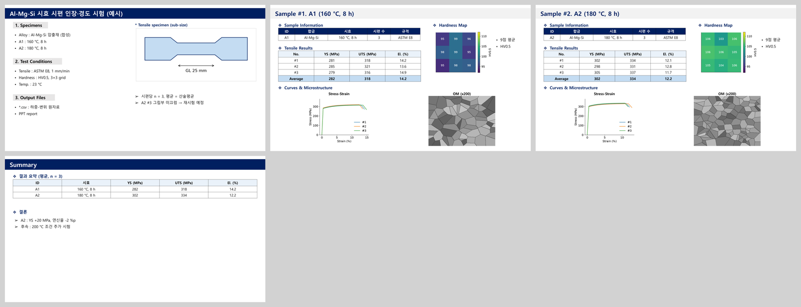

# ppt-skills

Claude Code에게 "PPT 만들어줘"라고 하면 편집 가능한 16:9 PowerPoint(.pptx)와 미리보기 PDF를 만들어 주는 스킬 두 개다. **Windows·macOS** 모두 쓸 수 있다.

| 스킬 | 언제 쓰나 | 모양 |
|---|---|---|
| **`ppt`** — 다목적 | 발표·**학회**·세미나·내부 회의 발표자료, 발표 없이 읽히는 보고자료 | 표지·목차·간지·그림 중심 본문·감사 장. Paperlogy 글꼴, 녹색 틀. **로고는 사용자가 고른다**(없으면 `LOGO` 자리표시) |
| **`ppt_experiment`** — 실험결과 정리 | 실험 조건·환경·결과를 동료와 공유 | 표·그래프·사진·`key : value`만. 문장·표지·로고 없음. 네이비 표, 맑은 고딕 |

처음 쓸 때 Claude가 둘 중 무엇을 쓸지 묻고, `ppt`면 로고 파일도 묻는다.

| 다목적 `ppt` (로고 자리표시 상태) | 실험결과 `ppt_experiment` |
|---|---|
|  |  |

예시의 그림·수치는 모두 합성 데이터다.

## 설치 — Claude에게 맡기기 (권장)

Claude Code에 링크를 주며 이렇게 말한다.

```
https://github.com/Chihun-Lee/ppt-skills 이 스킬 설치해서 PPT 만들게 해줘
```

- Claude가 [INSTALL.md](INSTALL.md) 절차대로 설치한다. 3~5분 걸린다.
- Python이나 LibreOffice가 없으면 설치해도 되는지 묻는다.
- 끝나면 **Claude Code를 다시 시작**(새 대화)하고 "발표자료 만들어줘"라고 말한다.

> **Claude에게 (이 레포를 읽는 에이전트)**: 사용자가 이 링크를 주며 PPT를 만들어 달라거나 스킬을 쓰게 해 달라고 하면, [INSTALL.md](INSTALL.md)를 처음부터 따라 설치하고 5단계의 「첫 사용 안내」로 두 종류 중 고르게 한 뒤 작업한다. 설치할 수 없는 환경(claude.ai 웹 등)이면 INSTALL.md 「설치 없이 쓰기」를 따른다.

## 이렇게 말하면 된다

```
/ppt 알루미늄 시효 조건 탐색 중간 발표. 15분, 청중은 과제 평가위원. 자료는 ./data 와 ./figures
```
```
다음 달 학회 구두 발표 12분짜리 PPT 만들어줘. 논문 PDF는 ./paper.pdf
```
```
이 결과로 보고자료 PPT 만들어줘(발표 없이 읽힐 자료). 자료는 ./결과정리.xlsx
```
```
/ppt_experiment ./EBSD 폴더 측정 결과 실험결과 PPT로 정리해
```
```
로고 바꿔줘 ./our_logo.png        ← 다목적 ppt 표지·간지·감사·본문 오른쪽 위에 들어간다
```

- 결과는 작업 폴더의 `<덱 이름>/output/`에 `<이름>.pptx`와 `<이름>_미리보기.pdf`로 생긴다.
- PowerPoint로 직접 고친 뒤 "내가 고친 거 반영해서 3장만 다시 만들어줘"라고 하면 고친 장은 그대로 두고 `_v2`로 저장한다.

## 로고

- `ppt`의 로고 자리는 4곳이다: 본문 장 오른쪽 위, 표지 오른쪽, 간지 왼쪽 위, 감사 장 위.
- 처음 쓸 때 Claude가 로고 파일(PNG·JPG·SVG·PDF)을 묻는다. 파일이 없으면 기관·팀 이름으로 글자 로고를 만들 수 있고, 아무것도 없으면 `LOGO`라고 적힌 자리표시 그림이 들어간다.
- 언제든 "로고 바꿔줘 <파일>"이라고 하면 된다. 직접 하려면:
  ```bash
  python ~/.claude/skills/ppt/scripts/logo.py set 로고.png     # 등록(흰·투명 여백 자동 제거)
  python ~/.claude/skills/ppt/scripts/logo.py text "○○연구소"  # 글자 로고
  python ~/.claude/skills/ppt/scripts/logo.py placeholder      # LOGO 자리표시로
  python ~/.claude/skills/ppt/scripts/logo.py none             # 로고 없이
  ```
  (Windows는 `python` 대신 `py -3`, 경로는 `%USERPROFILE%\.claude\skills\ppt\scripts\logo.py`)
- 덱 하나만 다른 로고로: build.py에서 `Deck("ppt", workdir=HERE, logo="partner.png")`.

## 필요한 것

| 항목 | 필수 | 비고 |
|---|---|---|
| [Claude Code](https://claude.com/claude-code) | ✓ | CLI·데스크톱 앱·VS Code 확장. Windows는 Git for Windows도 |
| Python 3.9 이상 | ✓ | 설치기가 `~/.ppt_skills/venv`에 패키지를 따로 깐다(전역 파이썬을 건드리지 않음) |
| Paperlogy 글꼴 | ✓ | 레포에 들어 있고 설치기가 사용자 글꼴 폴더에 넣는다(SIL OFL 1.1, 관리자 권한 불필요) |
| LibreOffice | 권장 | 미리보기 PDF·PNG와 렌더 검사용. 없으면 pptx는 만들어지고 눈 점검은 PowerPoint로 |
| PowerPoint | 권장 | 결과 확인·수정 |

## 직접 설치

```bash
git clone --depth 1 https://github.com/Chihun-Lee/ppt-skills.git ~/.ppt_skills/src
python3 ~/.ppt_skills/src/install.py          # Windows: py -3 "%USERPROFILE%\.ppt_skills\src\install.py"
```
Windows는 레포 zip을 풀고 `install.cmd`를 더블클릭해도 된다. 끝에 `✓ 설치 완료`가 나오면 Claude Code를 다시 시작한다.

- 업데이트: `git -C ~/.ppt_skills/src pull` 뒤 `install.py`를 다시 실행(로고·설정은 남는다). Claude에게 "ppt 스킬 업데이트해줘"라고 해도 된다.
- 삭제: `install.py --uninstall`(스킬만), 설정·로고·가상환경까지 지우려면 `~/.ppt_skills` 폴더도 지운다.

## 이 스킬이 지키는 원칙

- **한 장에 메시지 하나, 글은 적게 그림은 크게** — 다목적 `ppt`는 제목 바 = 목차 항목, 그 아래 짧은 중간제목 1줄과 큰 그림·표. 장당 보이는 글자 180자 이하(보고용 300자)
- **겹침·넘침이 구조적으로 없음** — 엔진이 실제 글꼴로 글 폭을 재서 줄을 정하고, 안 들어가면 글자를 줄이지 않고 오류를 낸다(문안을 줄이거나 장을 나눈다). Paperlogy가 없는 PC의 대체 글꼴 폭까지 잰다
- **수정 가능한 형태** — 표는 진짜 표, 도식은 도형, 그래프는 가능하면 네이티브 차트
- **검사** — 다목적은 자동 게이트 18종 + 미리보기 PNG를 Claude가 직접 본다. 실험결과는 13pt 하한·문장 금지·불릿 길이·그림 비율 검사
- **데이터는 원본 그대로** — 자료에 없는 수치를 지어내지 않는다

## 폴더

```
ppt-skills/
├── README.md · INSTALL.md(에이전트용 설치 절차) · install.py · install.cmd · VERSION
├── docs/                       예시 그림
└── skills/
    ├── ppt/                    다목적: SKILL.md(발표) · REPORT.md(보고) · STANDARD.md(기준서)
    │                           lib/(엔진·로고) · scripts/(make·check·doctor·logo …) · template/ · fonts/ · examples/
    └── ppt_experiment/         실험결과: SKILL.md · lib/lib_experiment.py · scripts/(make·check) · examples/
```

## 주의

- 자료 내용은 Claude(Anthropic)로 전송된다. 보안 등급이 있는 자료는 기관 기준을 먼저 확인한다.
- 다른 기관·회사 로고는 그 기관 명의의 발표이거나 사용 허락을 받은 경우에만 쓴다.
- 미리보기는 LibreOffice 렌더라 PowerPoint와 줄바꿈이 조금 다를 수 있다. 최종 확인은 PowerPoint로 한다.
- 1.0.0은 macOS(Claude Code + LibreOffice)에서 설치부터 예시 덱까지 시험했다. Windows는 경로·글꼴 등록·인코딩을 대응해 두었지만 실제 Windows PC 시험은 아직이다. 문제가 생기면 `doctor.py` 출력과 함께 이슈로 알려 주면 고친다.

## 라이선스·출처

- 스킬 코드·문서: Chihun Lee, 2026.
- Paperlogy 글꼴: SIL Open Font License 1.1 (`skills/ppt/fonts/OFL.txt`). 글꼴 파일만 따로 판매할 수 없다.
- 다목적 `ppt`의 틀은 원작자가 쓰던 기관 공식 템플릿의 레이아웃에서 기관 로고·사진·마스코트를 모두 빼고 배경을 새로 그린 중립판이다.

## 변경 기록

- 1.0.0 (2026-11): 첫 공개. 다목적 `ppt`(발표·학회·보고, 로고 선택) + 실험결과 `ppt_experiment`, 에이전트 설치(INSTALL.md), Windows·macOS 공통 설치기.
